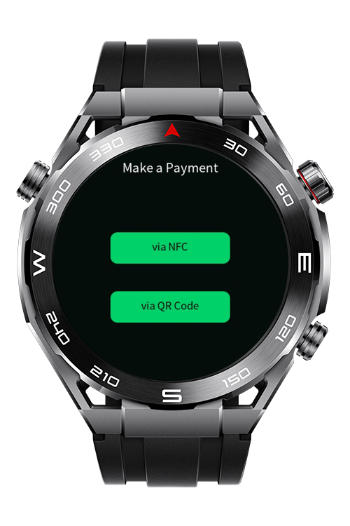
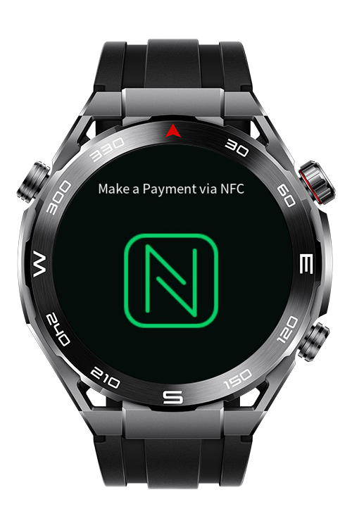
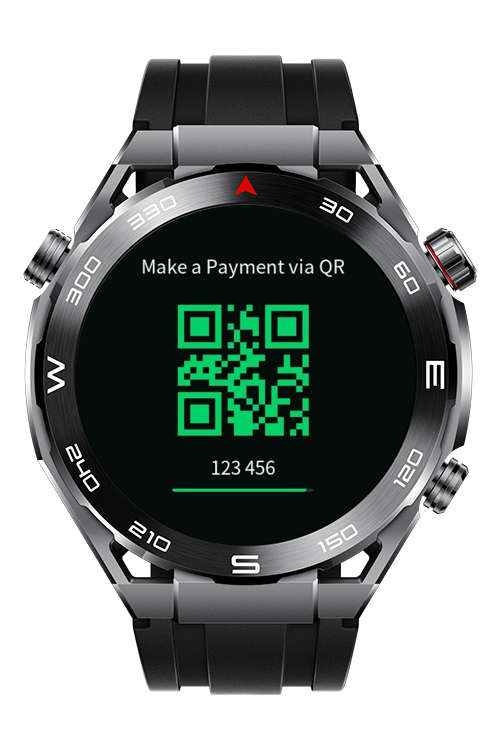

> **Note:** To access all shared projects, get information about environment setup, and view other guides, please visit [Explore-In-HMOS Index](https://github.com/Explore-In-HMOS/hmos-index).

# FoodTicketCard

This app simulates the functionality of a food card app. 
Data received from the phone via the Wear engine is stored and can be used for NFC (HCE payment), QR code, or 6-digit payment. 
The user can make payments using NFC, QR code, or a 6-digit code.

# Preview

<div>
  
  
  
</div>

# Use Cases

- Use NFC to make payments.
- Use QR or 6-digit to make payments.

# Technology

## Stack

- **Languages**: HML, JS
- **Frameworks**: 5.1.1(19)
- **Tools**: DevEco Studio Version 5.1.1.850
- **Libraries**:
    - @system.wearengine
    - @ohos.router
    - @system.storage
    - @system.file
    - @ohos.nfc.cardEmulation
    - @system.brightness
    - @system.vibrator

## Required Permissions

- `ohos.permission.NFC_CARD_EMULATION`
  > To make payment

## Documentation Link

- [Applying for the Wear Engine Service](https://developer.huawei.com/consumer/en/doc/connectivity-Guides/applying-wearengine-0000001050777982)
- [Wear Engine SDK](https://developer.huawei.com/consumer/en/doc/connectivity-Library/litewearable-sdk-cn-0000001705004353)
- [Lite Wearable App Development via Wear Engine](https://developer.huawei.com/consumer/en/doc/connectivity-Guides/fitnesswatch-dev-0000001051423561)
- [HCE Development](https://developer.huawei.com/consumer/en/doc/harmonyos-guides/nfc-hce-guide)

# Directory Structure

```
entry/src/main/js/MainAbility
│   app.js
│   
├───common
│   ├───img
│   │       xmark_circle_fill.png
│   └───js
│           router.js
├───pages
│   ├───index
│   │       index.css
│   │       index.hml
│   │       index.js
│   ├───nfcPayment
│   │       nfcPayment.css
│   │       nfcPayment.hml
│   │       nfcPayment.js
│   ├───noSuk
│   │       noSuk.css
│   │       noSuk.hml
│   │       noSuk.js
│   └───QRPayment
│           qrPayment.css
│           qrPayment.hml
│           qrPayment.js
│  
├───util 
│       dataStore.js
│       hce.js
│       keyStore.js
│        
└───wearenginesdk
        wearengine.js // Download the Wear Engine SDK and place it here.             
```

# Constraints and Restrictions

## Supported Device

- Huawei Sport (Lite) Watch GT 4/5/6
- Huawei Sport (Lite) GT4/5 Pro
- Huawei Sport (Lite) Fit 3/4
- Huawei Sport (Lite) D2
- Huawei Sport (Lite) Ultimate

## Requirements
  - After downloading the wear engine file from the document ([click to visit download page](https://developer.huawei.com/consumer/en/doc/connectivity-Library/litewearable-sdk-cn-0000001705004353)), place it in \entry\src\main\js\MainAbility\wearengine directory.
  - Set signing configs in build.profile.json5 and set package name and fingerprint in constants.
  - Also set your package name in hce.js for hce payment.
  - Build and run the app on a Huawei lite wearable.
  - Ensure the sport watch and mobile app are properly paired.

# License

**FoodTicketCard** is distributed under the terms of the MIT License
See the [LICENSE](./LICENSE) for more information.
